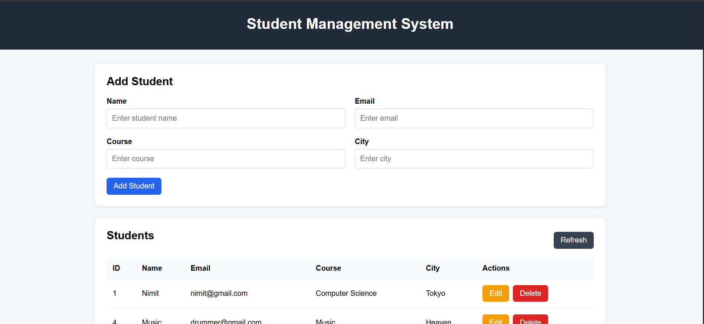

# 🎓 Student Management System

A full-stack **Student Management System** built using **Spring Boot, Spring Data JPA, Hibernate, MySQL, Maven, and React**.

The application provides a RESTful backend for managing student records and a React-based frontend for performing complete CRUD operations through a clean and responsive user interface.

---

## 📸 Application Dashboard

The application provides a simple dashboard where users can view all students and perform actions such as editing and deleting student records.



---

## ✨ Features

* ✅ Create a new student
* ✅ View all students
* ✅ View a student by ID
* ✅ Update student details
* ✅ Delete student
* ✅ Filter students by city
* ✅ Form validation
* ✅ Global exception handling
* ✅ Proper REST HTTP status codes
* ✅ React-based user interface
* ✅ REST API communication using Fetch API
* ✅ MySQL database persistence
* ✅ Hibernate ORM
* ✅ Layered backend architecture
* ✅ CORS configuration

---

## 🛠️ Technologies Used

### Backend

| Technology           | Purpose                         |
| -------------------- | ------------------------------- |
| ☕ Java 17            | Programming language            |
| 🌱 Spring Boot       | Backend framework               |
| 🌐 Spring Web        | REST API development            |
| 🗃️ Spring Data JPA  | Repository abstraction          |
| 🔄 Hibernate         | ORM / JPA implementation        |
| 📦 Maven             | Build and dependency management |
| ✅ Jakarta Validation | Request validation              |

### Database

| Technology | Purpose             |
| ---------- | ------------------- |
| 🐬 MySQL   | Relational database |

### Frontend

| Technology    | Purpose                         |
| ------------- | ------------------------------- |
| ⚛️ React      | User interface                  |
| ⚡ Vite        | Frontend development/build tool |
| 🟨 JavaScript | Frontend logic                  |
| 🎨 HTML/CSS   | UI structure and styling        |
| 🔗 Fetch API  | Backend communication           |

---

## 🏗️ Application Architecture

The application follows a layered architecture:

```text
                    ┌──────────────────────┐
                    │      React UI        │
                    │     Vite + JS        │
                    └──────────┬───────────┘
                               │
                         HTTP / JSON
                               │
                               ▼
                    ┌──────────────────────┐
                    │   REST Controller    │
                    └──────────┬───────────┘
                               │
                               ▼
                    ┌──────────────────────┐
                    │    Service Layer     │
                    │    Business Logic    │
                    └──────────┬───────────┘
                               │
                               ▼
                    ┌──────────────────────┐
                    │   Repository Layer   │
                    │   Spring Data JPA    │
                    └──────────┬───────────┘
                               │
                               ▼
                    ┌──────────────────────┐
                    │      Hibernate       │
                    │         ORM          │
                    └──────────┬───────────┘
                               │
                               ▼
                    ┌──────────────────────┐
                    │        MySQL         │
                    └──────────────────────┘
```

### Request Flow

For example, when a user creates a student:

```text
React Form
    ↓
POST /api/students
    ↓
StudentController
    ↓
StudentService
    ↓
StudentRepository
    ↓
Spring Data JPA
    ↓
Hibernate
    ↓
MySQL
```

The saved student is then returned to the React frontend as JSON.

---

## 📝 Student Management

The application provides a form for creating and updating student records.

Users can enter:

* Student name
* Email
* Course
* City


The same form is used for both creating and updating students.

---

## 🔗 REST API Endpoints

Base URL:

```text
http://localhost:8080/api/students
```

| Method | Endpoint                   | Description       | Status         |
| ------ | -------------------------- | ----------------- | -------------- |
| GET    | `/api/students`            | Get all students  | 200 OK         |
| GET    | `/api/students/{id}`       | Get student by ID | 200 OK         |
| GET    | `/api/students?city=Delhi` | Filter by city    | 200 OK         |
| POST   | `/api/students`            | Create student    | 201 Created    |
| PUT    | `/api/students/{id}`       | Update student    | 200 OK         |
| DELETE | `/api/students/{id}`       | Delete student    | 204 No Content |

---

## 🧪 REST API Example

### Create Student

```http
POST /api/students
Content-Type: application/json
```

Request:

```json
{
  "name": "Nimit",
  "email": "nimit@gmail.com",
  "course": "Computer Science",
  "city": "Delhi"
}
```

Response:

```json
{
  "id": 1,
  "name": "Nimit",
  "email": "nimit@gmail.com",
  "course": "Computer Science",
  "city": "Delhi"
}
```

---

## 🗃️ Database & Hibernate

The application uses **MySQL** as the relational database and **Hibernate** as the ORM implementation of JPA.

The `Student` entity is mapped to the `students` table.

```text
Student Entity
│
├── id
├── name
├── email
├── course
└── city
```

Hibernate handles the mapping between Java objects and relational database records.

---

## 🔐 Validation & Exception Handling

Incoming student data is validated using Jakarta Bean Validation.

Examples include:

```java
@NotBlank
@Email
```

Invalid data results in:

```text
400 BAD REQUEST
```

If a requested student does not exist:

```text
404 NOT FOUND
```

Exceptions are handled centrally using:

```java
@RestControllerAdvice
```

This keeps error-handling logic separate from the controller layer.

---

## 📂 Project Structure

```text
student-management-system/
│
├── frontend/
│   ├── src/
│   │   ├── App.jsx
│   │   ├── App.css
│   │   ├── index.css
│   │   └── main.jsx
│   │
│   ├── package.json
│   └── vite.config.js
│
├── src/
│   └── main/
│       ├── java/
│       │   └── com.example.studentmanagement/
│       │       │
│       │       ├── config/
│       │       │   └── CorsConfig.java
│       │       │
│       │       ├── controller/
│       │       │   └── StudentController.java
│       │       │
│       │       ├── entity/
│       │       │   └── Student.java
│       │       │
│       │       ├── exception/
│       │       │   ├── StudentNotFoundException.java
│       │       │   └── GlobalExceptionHandler.java
│       │       │
│       │       ├── repository/
│       │       │   └── StudentRepository.java
│       │       │
│       │       ├── service/
│       │       │   └── StudentService.java
│       │       │
│       │       └── StudentManagementApplication.java
│       │
│       └── resources/
│           └── application.properties
│
├── screenshots/
│   ├── dashboard.png
│   └── student-form.png
│
├── .gitignore
├── pom.xml
└── README.md
```

---

## ⚙️ How to Run

### Prerequisites

Make sure the following are installed:

* Java 17+
* Maven
* MySQL
* Node.js and npm
* IntelliJ IDEA or another Java IDE

### 1. Clone the repository

```bash
git clone <YOUR_GITHUB_REPOSITORY_URL>
cd student-management-system
```

### 2. Create the database

Open MySQL and run:

```sql
CREATE DATABASE student_management;
```

### 3. Configure MySQL

Open:

```text
src/main/resources/application.properties
```

Configure your local credentials:

```properties
spring.datasource.url=jdbc:mysql://localhost:3306/student_management
spring.datasource.username=root
spring.datasource.password=YOUR_MYSQL_PASSWORD

spring.jpa.hibernate.ddl-auto=update
spring.jpa.show-sql=true
spring.jpa.properties.hibernate.format_sql=true
```

> ⚠️ Never commit real database passwords or other secrets to GitHub.

### 4. Start Spring Boot

From the project root:

```bash
mvn spring-boot:run
```

Backend:

```text
http://localhost:8080
```

### 5. Start React

Open another terminal:

```bash
cd frontend
npm install
npm run dev
```

Frontend:

```text
http://localhost:5173
```

---

## 🧠 Key Concepts Demonstrated

This project demonstrates practical experience with:

* Spring Boot
* RESTful APIs
* Maven
* Dependency Injection
* Layered Architecture
* Spring Data JPA
* Hibernate ORM
* Entity Mapping
* Repository Pattern
* CRUD Operations
* MySQL
* Bean Validation
* Global Exception Handling
* HTTP Status Codes
* CORS
* React Hooks
* React State Management
* Fetch API
* JSON communication

---

## 🎯 Learning Outcome

This project provided practical experience in developing a full-stack application where a React frontend communicates with a Spring Boot REST API and persists data in MySQL using Spring Data JPA and Hibernate.

It also helped demonstrate how requests flow through the Controller, Service, and Repository layers and how Hibernate maps Java entities to relational database tables.

---

## 👨‍💻 Author

**Nimit Goyal**

Computer Science Engineering Student

---

⭐ Built as a practical full-stack project to strengthen Spring Boot, Hibernate, REST API, MySQL, Maven, and React development skills.
